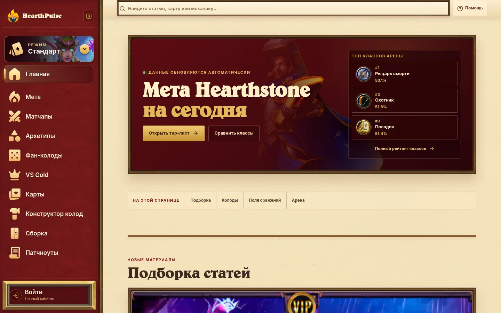
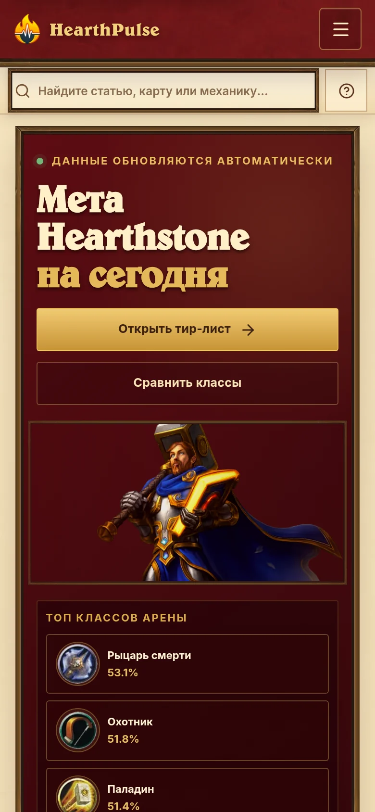
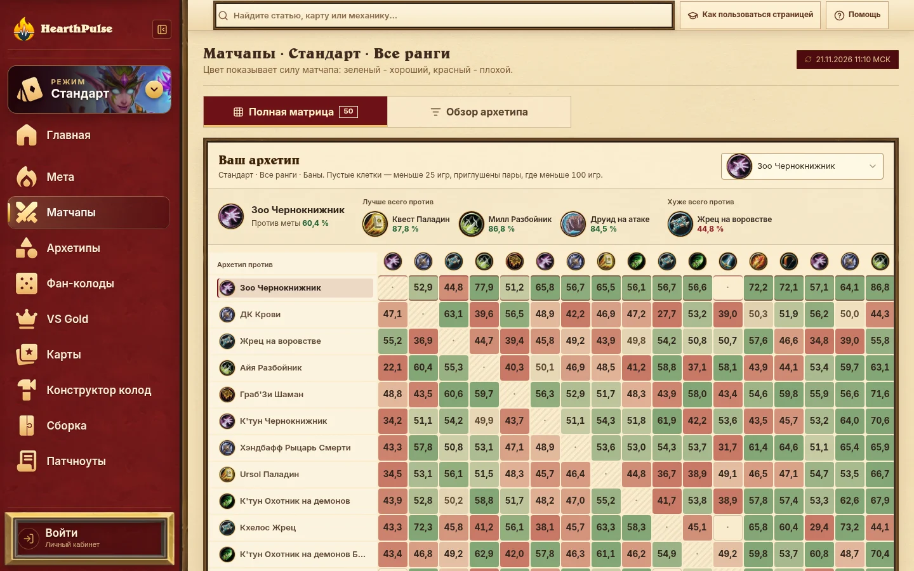
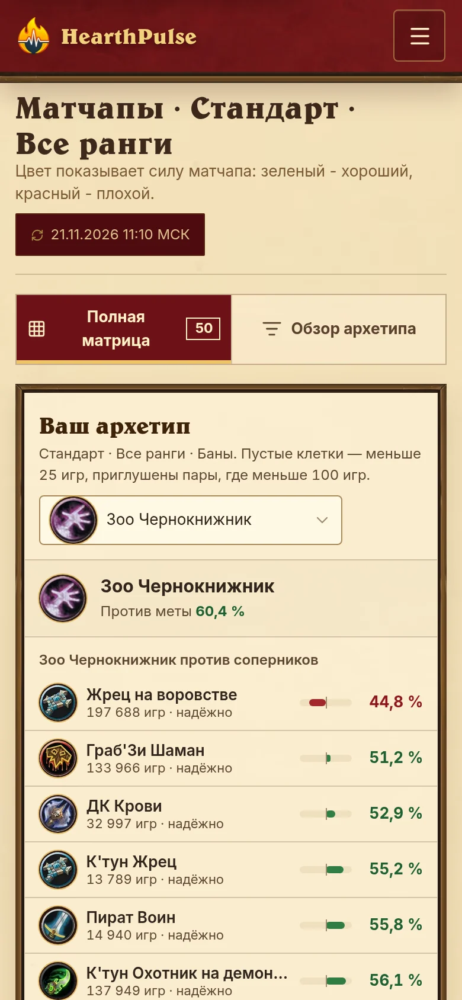
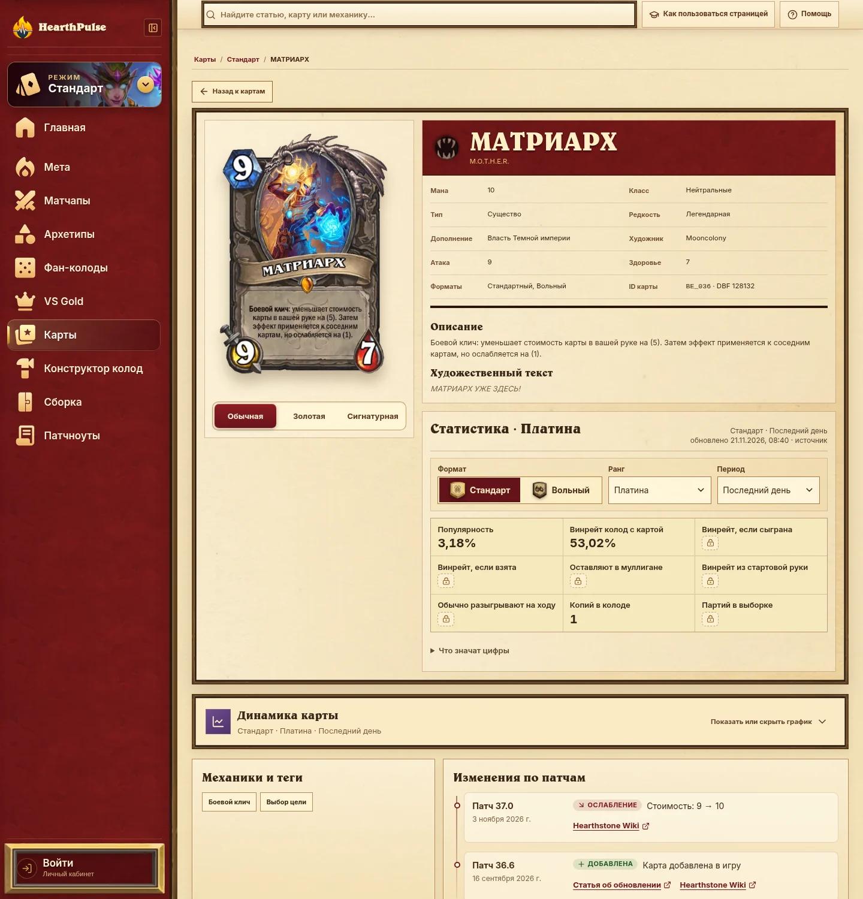
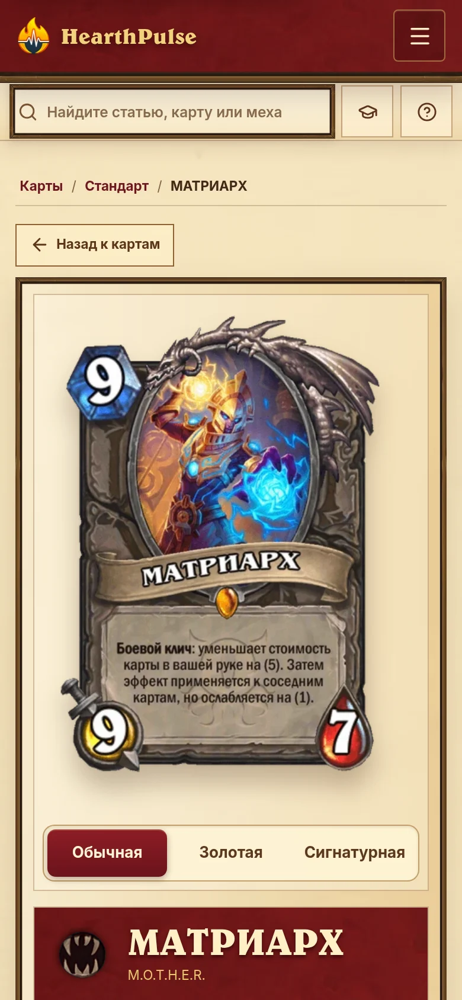
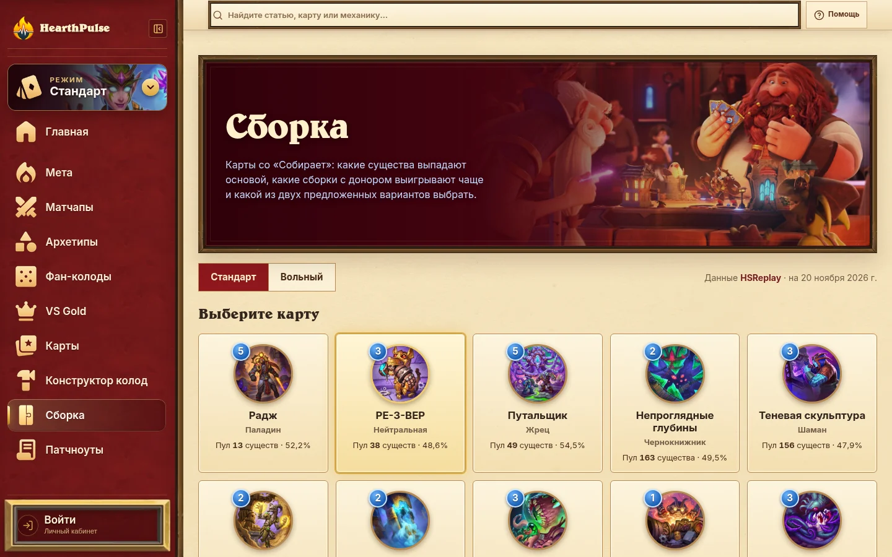
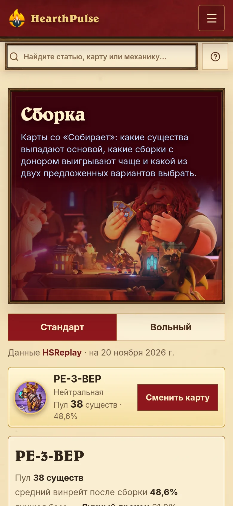

<!-- markdownlint-disable MD013 MD033 MD041 -->

<p align="center">
  <a href="https://hearthpulse.net">
    
  </a>
</p>

<h1 align="center">HearthPulse</h1>

<p align="center">
  <strong>Мета Hearthstone на русском: колоды, матчапы, карты, Арена и Поля сражений на одном сайте.</strong>
</p>

<p align="center">
  <a href="https://hearthpulse.net"><strong>hearthpulse.net</strong></a> ·
  <a href="#что-внутри">Режимы</a> ·
  <a href="#быстрый-старт">Быстрый старт</a> ·
  <a href="docs/architecture/ai-project-map.md">Карта проекта</a> ·
  <a href="CONTRIBUTING.md">Вклад</a> ·
  <a href="SECURITY.md">Безопасность</a> ·
  <a href="CHANGELOG.md">Изменения</a>
</p>

<p align="center">
  <a href="https://github.com/Manacost-Labs/HeartPulse/actions/workflows/ci.yml">
    
  </a>
  <a href="https://github.com/Manacost-Labs/HeartPulse/actions/workflows/codeql.yml">
    
  </a>
  <a href="https://github.com/Manacost-Labs/HeartPulse/actions/workflows/gitleaks.yml">
    
  </a>
  <a href="https://github.com/Manacost-Labs/HeartPulse/actions/workflows/osv-scanner.yml">
    
  </a>
  <a href="https://github.com/Manacost-Labs/HeartPulse/actions/workflows/trivy.yml">
    
  </a>
  <a href="https://github.com/Manacost-Labs/HeartPulse/actions/workflows/scorecard.yml">
    
  </a>
</p>

<p align="center">
  <a href="https://hearthpulse.net/api/health/ready">
    
  </a>
  <a href="https://nextjs.org/">
    
  </a>
  <a href="https://react.dev">
    
  </a>
  <a href="https://nodejs.org/">
    
  </a>
</p>

<table>
  <tr>
    <td width="72%">
      
    </td>
    <td width="28%">
      
    </td>
  </tr>
  <tr>
    <td align="center">Главная, 1440 px</td>
    <td align="center">Телефон, 390 px</td>
  </tr>
</table>

## Что внутри

| Режим | Что есть |
| --- | --- |
| [Стандарт](https://hearthpulse.net/standard/) | [Мета](https://hearthpulse.net/standard/meta/) и [матчапы](https://hearthpulse.net/standard/matchups/) по рангам и периодам, [архетипы](https://hearthpulse.net/standard/archetypes/), [лучшие колоды](https://hearthpulse.net/standard/decks/) и [фан-колоды](https://hearthpulse.net/standard/fun-decks/), [карты](https://hearthpulse.net/standard/cards/) со статистикой и историей изменений, [«Сборка»](https://hearthpulse.net/standard/assemble/), [Vicious Syndicate Gold](https://hearthpulse.net/standard/vicious-gold/), [конструктор колод](https://hearthpulse.net/standard/deck-builder/), [патчноуты](https://hearthpulse.net/standard/patches/) |
| [Вольный](https://hearthpulse.net/wild/) | [Мета](https://hearthpulse.net/standard/meta/wild/), [архетипы](https://hearthpulse.net/standard/archetypes/wild/), [матчапы](https://hearthpulse.net/standard/matchups/?format=wild), [карты](https://hearthpulse.net/standard/cards/wild/), [«Сборка»](https://hearthpulse.net/standard/assemble/?format=wild) и [конструктор](https://hearthpulse.net/standard/deck-builder/?format=wild) в формате Вольного |
| [Арена](https://hearthpulse.net/arena/) | [Тир-лист карт](https://hearthpulse.net/tierlist/), [винрейты классов](https://hearthpulse.net/classes/), [легендарки](https://hearthpulse.net/legendaries/) |
| [Поля сражений](https://hearthpulse.net/battlegrounds/) | [Герои](https://hearthpulse.net/heroes/), [библиотека](https://hearthpulse.net/library/), [тир-лист](https://hearthpulse.net/battlegrounds/tier-list/), [стратегии](https://hearthpulse.net/battlegrounds/strategies/), [конструктор тир-листа](https://hearthpulse.net/battlegrounds/tier-builder/) |

Общее для всех режимов: [еженедельные мета-отчёты](https://hearthpulse.net/reports/meta/)
(по понедельникам), [статьи](https://hearthpulse.net/articles/),
[таблицы лидеров](https://hearthpulse.net/leaderboards/),
[косметика](https://hearthpulse.net/cosmetics/) и
[открытый API](https://hearthpulse.net/developers/api/).

## Интерфейс в деталях

<table>
  <tr>
    <td width="72%">
      
    </td>
    <td width="28%">
      
    </td>
  </tr>
  <tr>
    <td align="center" colspan="2">Матчапы: полная матрица и разбор архетипа</td>
  </tr>
  <tr>
    <td width="72%">
      
    </td>
    <td width="28%">
      
    </td>
  </tr>
  <tr>
    <td align="center" colspan="2">Карта: статистика и история изменений по патчам</td>
  </tr>
  <tr>
    <td width="72%">
      
    </td>
    <td width="28%">
      
    </td>
  </tr>
  <tr>
    <td align="center" colspan="2">«Сборка»: какие основы выпадают и какой вариант выбрать</td>
  </tr>
</table>

Скриншоты сняты с production гостем, без входа в аккаунт. Обновить их:
`npm run docs:screenshots`.

<a id="зачем-этот-проект"></a>

## О проекте

- **Гость видит тот же интерфейс, что и подписчик.** Те же страницы, фильтры и
  таблицы; открытый срез показан числами, платные значения — замками на своих
  местах. Подписка снимает замки.
- **Данные обновляются сами.** У каждого набора указаны источник и время
  обновления; при сбое источника сайт показывает последний сохранённый снимок.
- **Работает на телефоне.** Интерфейс от 320 px, клавиатура, 200% reflow и
  axe-аудит входят в обязательные проверки.

## Архитектура

Начинайте с [карты проекта](docs/architecture/ai-project-map.md): в ней
владельцы модулей и источники истины. Границы модулей —
[module-boundaries.md](docs/architecture/module-boundaries.md).

```text
Browser
  │
  ├── Next.js 16.4 App Router (apps/public-web) + React 19 + TypeScript
  │     ├── server-rendered metadata and public data
  │     ├── client pages from src/modules and legacy src/features
  │     └── responsive Hearthstone UI
  │
  └── /api/*
        ├── Express API (compiled TypeScript)
        ├── signed authentication and CSRF boundary
        ├── Redis-assisted caches and durable snapshots
        ├── isolated scraper publication
        └── health, readiness, freshness and metrics contracts

Nginx → immutable release → systemd service
             │
             ├── atomic switch and automatic rollback
             └── encrypted backup and restore drills
```

```text
apps/public-web/      Next.js-приложение: все публичные HTML-страницы
src/modules/          доменные модули с узкими public-контрактами
src/features/         legacy-страницы на поэтапной миграции, не целевая граница
src/components/       общие UI-компоненты
server/app/           application wiring и lifecycle-композиция
server/modules/       каталогизированные backend-домены
scripts/              QA, бюджеты, релизы, мониторинг и recovery
tests/                unit, integration, contract, browser и smoke
deploy/               systemd units, Nginx и инфраструктурные шаблоны
public/               локальные игровые и декоративные ассеты
docs/                 спецификации, ADR, runbooks и скриншоты
```

## Качество и безопасность

Изменения попадают в `main` только через pull request и merge queue: очередь
проверяет PR поверх свежего `main`, её push выкатывает релиз
([runbook](docs/runbooks/agent-integration.md),
[ADR](docs/decisions/2026-10-21-pull-requests-and-merge-queue.md)).
Единый gate:

```bash
npm run verify:ci
```

- TypeScript, oxlint, архитектурные границы и clean-code ratchet;
- пять автоматически обнаруживаемых suite: unit, integration, contract,
  browser и production-smoke;
- сборка frontend и server, бюджеты JS/CSS каждой страницы;
- desktop/mobile E2E, axe, 200% reflow, клавиатура;
- markdownlint и проверка `design.md`.

Цепочку поставки защищают CodeQL, Semgrep, Gitleaks, Dependabot, OSV-Scanner,
Dependency Review, Trivy и OpenSSF Scorecard. После выкладки прод проверяют
`production-monitor` и `observe:production`
([runbook](docs/runbooks/production-observer.md)). SLO и правила остановки —
в [STABILIZATION.md](STABILIZATION.md).

## Стек и инструменты

| Контур | Инструменты |
| --- | --- |
| Интерфейс | Next.js 16.4.5 (App Router), React 19, TypeScript с измеряемым долгом и strict islands, Tailwind CSS 4, Lucide |
| API и данные | Node.js 22, Express, Redis, SQLite, Sharp, Puppeteer Core, node-cron, Hearthstone deckstrings |
| Тесты | Node test runner, tsx, fast-check, Storybook 10, Puppeteer, axe-core, Stryker |
| Качество | tsgo, oxlint, React Doctor, Knip, markdownlint, design.md, бюджеты бандла |
| Безопасность | CodeQL, Semgrep CE, Gitleaks, Trivy, OSV-Scanner, Dependabot, OpenSSF Scorecard |
| Наблюдаемость | Sentry (opt-in, без PII), readiness и метрики, production monitor и browser observer |
| Доставка | GitHub Actions, merge queue, immutable artifacts, Nginx, systemd, rollback, encrypted backups |

Команды и настройки для AI-агентов — в [docs/agent-tooling.md](docs/agent-tooling.md).

## Быстрый старт

Нужны Node.js 22.12+, npm и Chromium/Google Chrome (browser QA и scraper).

```bash
git clone https://github.com/Manacost-Labs/HeartPulse.git
cd HeartPulse
npm ci
cp .env.example .env
npm run dev
```

Сайт откроется на `http://localhost:3000`: API (порт 3001), Next.js (порт 4320)
и локальный шлюз, который раздаёт страницы, `/api` и статику как Nginx на проде.
Без внешних ключей работают локальные snapshots.

| Команда | Назначение |
| --- | --- |
| `npm run dev` | API, Next.js и шлюз в watch-режиме |
| `npm run storybook` | Storybook и его MCP на `http://127.0.0.1:6006` |
| `npm test` | Все пять suite из `tests/test-suites.json` |
| `npm run test:module -- <module>` | Тесты одного модуля |
| `npm run architecture:map` | Карта модулей и владельцев |
| `npm run architecture:impact -- <file>` | Контракт, зависимости и тесты файла |
| `npm run architecture:owner -- <method> <route>` | Владелец frontend/API route |
| `npm run agent:integrate` | Ветка → PR → merge queue ([runbook](docs/runbooks/agent-integration.md)) |
| `npm run docs:screenshots` | Скриншоты README с production |
| `npm run verify:ci` | Полный обязательный gate |

## Production-релиз

Релиз собирает и выкатывает merge queue: immutable-артефакт, атомарное
переключение symlink, readiness gate и автоматический rollback. Ручной сценарий,
recovery, encrypted backup и off-site replication — в
[DEPLOYMENT.md](DEPLOYMENT.md).

## Участие в проекте

Ошибки и идеи — через
[GitHub Issues](https://github.com/Manacost-Labs/HeartPulse/issues/new/choose).
Перед pull request прочитайте [CONTRIBUTING.md](CONTRIBUTING.md). Уязвимости —
только через
[приватный security advisory](https://github.com/Manacost-Labs/HeartPulse/security/advisories/new).

История изменений — [CHANGELOG.md](CHANGELOG.md); новые записи — по одному файлу
в [changelog.d/](changelog.d/README.md).

## Дизайн-система

Визуальный контракт — [design.md](design.md); токены, CSS-рецепты рам и каталог
production URL ассетов — [assets.md](assets.md).

## Источники и права

Статистика агрегируется из игровых и аналитических источников, указанных в
интерфейсе рядом с соответствующими наборами данных. Hearthstone и связанные
изображения принадлежат Blizzard Entertainment. Репозиторий не является
официальным продуктом Blizzard.

Исходный код является проприетарным. Копирование, публикация, модификация,
использование в другом продукте и создание производных работ запрещены без
предварительного письменного разрешения Manacost. Полные условия находятся в
[LICENSE](LICENSE). По вопросам проекта:
[Manacost в Telegram](https://t.me/manacost_ru).

Сделано командой Manacost для русскоязычного сообщества Hearthstone.
