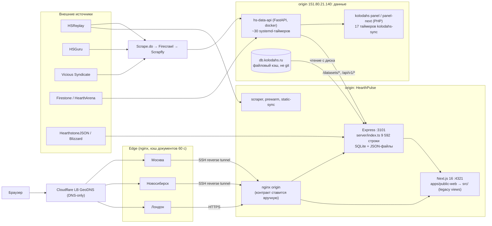
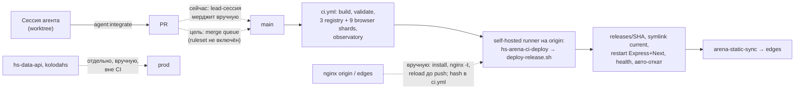
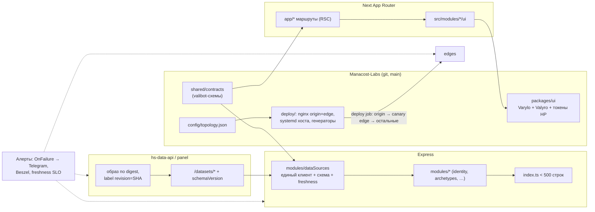

# План улучшения архитектуры HearthPulse (2026-10)

<!-- markdownlint-disable MD013 -->

Статус: предложение, 2026-10-21. База: `origin/main` `6e576e9b` (он же в
prod). Исследование только на чтение: код, `git log`, история CI за три дня,
состояние хоста (systemd, docker, релизы). Документ дополняет
[`modularization-plan.md`](modularization-plan.md) и
[`module-boundaries.md`](module-boundaries.md), а не заменяет их: там правила
модулей, здесь — системные проблемы вокруг них (данные, инфраструктура,
процесс) и порядок их устранения.

## 1. Текущая архитектура

### 1.1 Компоненты

### 1.2 Поток данных

| Шаг | Где | Контракт сейчас |
| --- | --- | --- |
| 1. Сбор | hs-data-api: таймеры `hs-data-api-docker-*` через Scrape.do (порядок провайдеров — `docs/SCRAPE_PROVIDERS.md` hs-data-api) | Python-модели внутри сервиса |
| 2. Публикация | `/datasets/<id>` (hsguru_*, hsreplay_*, vicious_syndicate_*, firestone_*), PHP-панель `/api/v1/*`, `/api/bg/*` | Нет опубликованной схемы и версии |
| 3. Чтение | Express: `fetchDataset` (`server/index.ts:5544`) и ~15 клиентов в `server/*.ts`; URL `api.kolodahearthstone.com` захардкожен в ~10 файлах | `upstream.json()` без проверки, 12 `res.json() as …` |
| 4. Проекция | Express `/api/*` → Next-loaders `apps/public-web/lib/public*Data.ts` | Ручные валидаторы в 12 файлах; типы берутся из `src/features/*` |
| 5. Доставка | Next SSR / клиентский рендер legacy-вида → nginx origin → edge-кэш → браузер | Кэш-ключ edge, ручная очистка |

### 1.3 Поток выкладки

### 1.4 Что уже работает и сохраняется

- Неизменяемые релизы HearthPulse: `releases/<SHA>`, атомарный symlink,
  health-check и автоматический откат приложения (`scripts/deploy-release.sh`).
- Контроль границ модулей: 45 модулей, 0 нарушений, 0 runtime-циклов,
  ratchet-бюджеты размеров файлов и функций (`npm run lint:architecture`).
- Next.js — владелец HTML всех 47 маршрутов инвентаря, Vite выведен
  2026-09-30.
- 2026-10-21 добавлены `changelog.d/`, approvals бюджетов бандла, шардирование
  CI, reuse проверки очереди и подготовленный ruleset merge queue.

## 2. Проблемы

Серьёзность: **К** — риск инцидента в prod или потери данных; **В** —
регулярно тормозит разработку или ломает выкладку; **С** — копит долг.

### 2.1 Процесс и интеграция

| # | Проблема | Доказательство | Влияние | С. |
| --- | --- | --- | --- | --- |
| P1 | Интеграция не защищена | `gh api …/rulesets` → `[]`, `main` без branch protection (404), `allow_auto_merge=false`; 88 коммитов в `main` за 7 дней, 0 merge-коммитов, все — прямые push | Любая сессия может сломать `main` и сразу prod; lead-сессия — ручное узкое место | К |
| P2 | Общие «горячие» файлы | За 7 дней: `CHANGELOG.md` 32 из 88 коммитов, `tests/test-suites.json` 20, `scripts/e2e-qa.mjs` 16, `server/index.ts` 14, `ci.yml` 13 (в т. ч. hash nginx-контракта), `config/*budgets*.json` 7–11, `src/vendor/varylo-ui/README.md` 6 | Конфликты при каждом rebase, ручные разрешения, потерянные записи | В |
| P3 | Коллизии нумерации ADR | `docs/decisions`: три `010-*`, два `011-*`, параллельно `0001-` и `001-` | Ссылки «ADR-010/011» неоднозначны | С |
| P4 | 69 связанных worktree | `git worktree list`: 70 строк, часть с сентября | Preflight медленнее и шумнее, риск правок в чужом дереве | С |

### 2.2 Источники данных и контракты

| # | Проблема | Доказательство | Влияние | С. |
| --- | --- | --- | --- | --- |
| P5 | hs-data-api в prod не соответствует ни одному коммиту | Образ `hs-data-api:local` = базовые слои (без revision label) + overlay `COPY app/hsguru_*.py`, `LABEL com.koloda.patch=archetype-decks-wider-window-8d0bb26`; checkout `d514322` отстаёт от `origin/main` на 15 коммитов; контейнер поднят из `docker-compose.yml`, а не `docker-compose.prod.yml`; 9 rollback-тегов, overlay-патчи — повторяющаяся практика | Невоспроизводимый prod: следующий честный build откатит или сломает HSGuru-сборки; откат «на что» неизвестен | К |
| P6 | Дрейф kolodahs | `panel/current` → `e139405`, `panel-next/current` → `d81436b` (разные коммиты); 87 каталогов релизов со смешанными именами; WordPress-checkout: 7 грязных файлов, 27 коммитов позади; 7 юнитов `kolodahs-sync@*` в состоянии failed | Неясно, какой код отдаёт данные; синки тихо стоят | В |
| P7 | Чтение чужого файлового кэша с диска | `server/index.ts:492` читает `db.kolodahs.ru/var/wiki-hs-cache/*` (не git, mtime 2026-08-12, ~70 дней) | Скрытая связность между системами, устаревшие данные без сигнала | В |
| P8 | Нет типизированных контрактов | 0 импортов zod/valibot/ajv (`valibot` только закреплён в `overrides`); `fetchDataset` возвращает `any`; 318 `any` в `server/`, `explicitAny=579` по проекту; `tsconfig.json` `strict: false`; Next-валидатор `publicArchetypeTeaserData.ts` берёт тип из `src/features/ConstructedArchetypes` | Изменение формата в hs-data-api обнаруживается пользователем, а не тестом; тип контракта живёт в legacy-виде | В |
| P9 | Перевод архетипов в пяти местах | Три substring-матчера: `server/constructedCardRoutes.ts:387`, `server/deckBuilderResolve.ts:149`, `server/modules/constructedArchetypes/archetypeLabel.ts:11` (другой формат вывода); статические словари `server/index.ts:4341` (76) и `src/features/StandardMatchups.tsx:89` (59); плюс БД-переводы | Одинаковые русские имена у разных архетипов (случай Summoner Mage), разные подписи на разных страницах | В |

### 2.3 Код

| # | Проблема | Доказательство | Влияние | С. |
| --- | --- | --- | --- | --- |
| P10 | `server/index.ts` не уменьшается | 9 950 строк (2026-07-29) → 9 592 (сегодня): −358 за три месяца при цели < 500; 329 функций верхнего уровня, 144 импорта, auth/Telegram/подписки и `fetchDataset` внутри; 282 `any` | Самая частая причина конфликтов в серверном коде; любое изменение тянет весь файл в ревью | В |
| P11 | `src/features/Battlegrounds.tsx` | 3 574 строки, бюджет 3 720, 95 `any`; рядом `BgLibrary.tsx` 1 537, `DeferredRoutes.tsx` 2 044 | Параллельная работа над BG почти невозможна | В |
| P12 | Legacy `src/` под Next | `apps/public-web` — 5,7 тыс. строк, `src/` — 84 тыс.; Next импортирует `src/features` 35 раз, `src/app` 45; README Next: «most pages still render legacy React views on the client» | Две модели загрузки данных, SSR не используется для основного контента | С |
| P13 | Вендоренная дизайн-система | `src/vendor/varylo-ui` 1,2 МБ и `valyro-ui` 0,5 МБ — копии реестра с локальными правками, перечисленными в README; маппинг `--ui-*` токенов размазан по 4 CSS-файлам фич | Обновление из upstream — ручной merge; README — горячий файл | С |
| P14 | Смешанное хранилище | `node:sqlite` в 5+ модулях и ~11 JSON-файлов, читаемых `server/index.ts` (`articles.json`, `tierlist.json`, …) в `shared/server-data` | Нет миграций и единой точки бэкапа/схемы | С |

### 2.4 Инфраструктура, CI и наблюдаемость

| # | Проблема | Доказательство | Влияние | С. |
| --- | --- | --- | --- | --- |
| P15 | nginx вне конвейера | `deploy/nginx` — шаблоны; по `production-deployer-contract.md` контракт ставится на origin вручную до push, hash вписывается в `ci.yml`; откат релиза не откатывает `/etc/nginx` и edges (`DEPLOYMENT.md`); Лондон был доверен на origin раньше, чем в репозитории (`528c541c`) | Изменение маршрута = ручной root-шаг; prod-конфиг расходится с git | К |
| P16 | Хостовые юниты не версионированы | cert-sync, edge-monitor, shadow-monitor, Beszel-backup живут только на хосте. Cert-таймеры включены, но hook `deploy-hearthpulse-cert.sh` захардкодил выключенный Limburg и не знает Лондон; `job-edge-cert-sync` упал 2026-10-21 00:23 | Сертификат Лондона не синхронизируется автоматически; список edge в 4+ местах | К |
| P17 | Очистка edge-кэша вручную | Единственный способ — `find /var/cache/nginx/hearthpulse-documents -type f -delete` на каждом edge или `grep -rl KEY \| xargs rm` в зоне, общей с другими сайтами (runbooks edge-caching, domain-migration); удаление файлов в обход nginx рассинхронизирует индекс `keys_zone` с диском | После отката приложения edge отдаёт старые документы; инцидент с индексом кэша | В |
| P18 | Нет алертинга | `production-monitor.md`: проваленный workflow «не канал пейджинга», STAB-405 открыт; ни у одного юнита нет `OnFailure=`; сейчас 14 failed-юнитов, в т. ч. `hs-arena-scraper`, `hearthpulse-shadow-monitor` (~300 падений с 2026-10-20: не знает IP Лондона), `arena-geodns-monitor.timer` выключен | Поломки синков и мониторов замечают люди, через дни | К |
| P19 | Нестабильный и долгий CI | `ci.yml` за 3 дня: 117 запусков, 42 failure, 8 cancelled; 3 обрыва по таймауту 20/30 мин; push в `main`: медиана 11,7, p90 27,7, максимум 61,6 мин; flaky browser-тесты: `next-instant-access`, `vicious-gold-*`, `constructed-archetypes`, `archetypes-detail`, `battleground-builders`, `skeleton-geometry`; раннер запускает тест-файлы последовательно, по процессу на файл | Сессии ждут и перезапускают CI; «красный» CI перестаёт быть сигналом | В |
| P20 | Инвентарь сервисов неполон | `config/runtime-service-inventory.json` (изменён 2026-10-02): нет Next, edges, SSH-туннелей, Cloudflare; Limburg офлайн с ~2026-10-05, но остаётся в скриптах | Нет единого источника топологии для мониторинга и скриптов | С |

## 3. Целевая архитектура

### 3.1 Принципы

1. **Prod = коммит в `main`.** Каждый работающий артефакт (релиз
   HearthPulse, образ hs-data-api, релиз панели, конфиг nginx на origin и
   edges, юниты хоста) собран из `main` своего репозитория и помечен SHA.
   Overlay-образы и правки на хосте запрещены; срочный hotfix — это PR,
   смёрдженный в тот же день.
2. **Инфраструктура как код с одним инвентарём.** `config/topology.json`
   (origin, edges, роли, туннели, пулы Cloudflare) — единственный список
   узлов. Из него генерируются цели cert-sync, static-sync, мониторов и
   проверки GeoDNS.
3. **Один контракт на домен.** `shared/contracts/<domain>.ts`: схема valibot
   (уже в зависимостях) → выведенный тип → проверка на каждой границе
   (клиент hs-data-api, ответ Express, Next-loader). Тип контракта не живёт во
   view.
4. **Модуль владеет поведением, композиция только связывает.**
   `app → modules → shared` из `module-boundaries.md`; `server/index.ts` и
   `apps/public-web/app/*` — только wiring.
5. **Сгенерированное не правят руками.** Агрегаты (CHANGELOG, реестр тестов,
   бюджеты, hash контракта) собираются из фрагментов или вычисляются.
6. **Каждый сбой виден в течение 15 минут.** Падение юнита, деградация
   источника данных или edge — сообщение в один канал.

### 3.2 Целевое устройство

### 3.3 По областям

- **Сервер.** `index.ts` — композиция < 500 строк (критерий выхода уже
  записан в `config/architecture-catalog.json`). Выносить по доменам: identity
  (auth, Telegram, подписки) → `server/modules/identity`; `fetchDataset` и все
  клиенты hs-data-api → `server/modules/dataSources`; именование архетипов →
  `server/modules/constructedArchetypes/naming`; таймеры процесса →
  `server/modules/jobs`; JSON-хранилища → репозитории модулей с миграциями
  SQLite.
- **Данные.** hs-data-api добавляет в envelope датасета `schemaVersion` и
  `generatedAt` (в HearthPulse уже есть `shared/datasetEnvelope.ts`).
  HearthPulse проверяет схему один раз на входе; несовпадение → 502 из API,
  последний валидный снимок в кэше и алерт. Контрактные тесты в обоих
  репозиториях на одних и тех же записанных фикстурах.
- **Фронтенд.** Маршрут Next загружает данные на сервере и рендерит виджеты
  модуля; `src/features` заморожен (новых файлов нет, бюджет строк только
  снижается), вид переезжает в `src/modules/<domain>/ui` при первой
  содержательной правке. Массовых переносов каталогов нет — они создают
  конфликты со всеми сессиями.
- **Дизайн-система.** npm-workspace `packages/ui`: Varylo, Valyro, токены
  HearthPulse (единый маппинг `--ui-*`), `TierBadge` и общие примитивы.
  Локальные правки — серия патчей в `packages/ui/patches/` (по файлу на
  изменение), версия и changelog пакета, Storybook рядом с пакетом, один
  владелец.
- **Релизы и инфраструктура.** Deployer ставит nginx origin из релиза:
  `nginx -t`, reload, откат вместе с symlink. Затем deploy job раскатывает
  edge-конфиг: Лондон (canary) → Москва → Новосибирск с health-check после
  каждого. hs-data-api и панель собираются в CI из `main`, выкатываются по
  digest/SHA тем же паттерном «релиз + symlink + health + откат».
- **Кэш.** В ключ документного кэша edge входит идентификатор релиза
  (заголовок от origin), поэтому откат не требует purge. Точечный purge — скриптом из репозитория в
  отдельной зоне только для HearthPulse, без ручного `rm` в общей зоне.
- **Наблюдаемость.** Шаблон `notify-failure@.service` (Telegram-бот уже есть
  для changelog) на все юниты; алерты Beszel по ресурсам; freshness SLO по
  каждому датасету в `/api/health/data`; ежечасный drift-отчёт: SHA каждого
  компонента и hash nginx против `main`.

## 4. Дорожная карта

Размеры: **S** ≤ 1 дня, **M** 2–4 дня, **L** 1–2 недели одной сессии.
Фазы 1–2 и 4 частично параллельны; фаза 3 начинается после фазы 2 по домену.

### Фаза 0. Быстрые победы (1–2 дня)

Цель: остановить дрейф и шум, включить защиту `main`.

| Задача | Р. | Критерий готовности |
| --- | --- | --- |
| Q1. Включить ruleset `.github/rulesets/main-merge-queue.json`, merge queue и auto-merge (владелец, по `agent-integration.md`) | S | `rulesets` не пуст; следующие 10 PR вошли через очередь; прямых push в `main` — 0 |
| Q2. Пересобрать hs-data-api из `origin/main` с `--label org.opencontainers.image.revision=<SHA>`; `deploy-server.sh` отказывается собирать грязное или отстающее дерево; одна compose-конфигурация | S | `docker inspect` label = `origin/main`; нет `com.koloda.patch`; checkout = `origin/main` |
| Q3. Алерты: `OnFailure=notify-failure@%n` на юниты HearthPulse, hs-data-api, kolodahs и edge; убрать Limburg и добавить Лондон в cert-hook, shadow-monitor и edge-monitor | S | Тестовый алерт пришёл; `systemctl --failed` пуст или каждая запись известна |
| Q4. Единое именование архетипов: одна функция `archetypeLabel()` в `server/modules/constructedArchetypes`, три вызова переведены на неё, словари из `index.ts` и `StandardMatchups.tsx` удалены, проверка дубликатов русских имён в админке | S–M | Один матчер в коде; golden-тест на ≥ 100 имён; 0 одинаковых RU-имён у разных архетипов |
| Q5. Убрать оставшиеся горячие точки: `agent:integrate` отклоняет ручное повышение бюджетов, ADR именуются `YYYY-MM-DD-slug.md`, локальные правки vendor — по файлу на правку вместо README | S | За неделю 0 коммитов задач в `CHANGELOG.md`, бюджеты и vendor README |
| Q6. Карантин flaky-тестов: 6 названных browser-тестов — в неблокирующий шард с задачей на починку; retry-pass считается падением в отчёте | S | 5 подряд зелёных прогонов `main` без retry |
| Q7. Выровнять kolodahs: `panel` и `panel-next` на один SHA `main`, оставить 10 релизов, починить 7 `kolodahs-sync@*` | S | Оба `current` указывают на один SHA; failed sync-юнитов 0 |

Риски: включение очереди до первого прогона `CI required` блокирует merge
(порядок шагов в runbook). Откат: выключить ruleset; образ hs-data-api
откатывается на тег `pre-archetype-decks-20261021`.

### Фаза 1. Релизы и инфраструктура как код (1–2 недели)

Цель: изменение маршрута или edge проходит через PR без ручных root-шагов.

| Задача | Р. | Критерий готовности |
| --- | --- | --- |
| 1.1 `config/topology.json` и генератор целей cert-sync, static-sync, мониторов; проверка в CI | M | Добавление/удаление edge — правка одного файла |
| 1.2 Deployer ставит nginx origin из релиза и откатывает вместе с symlink; hash в `ci.yml` заменяется сгенерированным `deploy/nginx/CONTRACT.sha256` с обязательным ревью владельца | M | PR с новым маршрутом выкатывается без ручного шага; откат восстанавливает nginx |
| 1.3 Раскатка edge в deploy job: canary Лондон → Москва → Новосибирск, health и автоматический откат узла | M | Edge-конфиг на всех узлах = `main` (drift-отчёт) |
| 1.4 Юниты хоста (cert-sync, мониторы, синки) в `deploy/systemd/host/` с `--check` на drift | M | `install --check` = 0 расхождений |
| 1.5 CI hs-data-api: build образа на `main`, деплой по digest, таймеры используют тот же digest | L | Последние 5 выкладок hs-data-api — из CI; ручных `docker build` нет |
| 1.6 Деплой панели kolodahs из CI на `main` | M | Релиз панели = SHA `main` после каждого merge |
| 1.7 Ежечасный drift-отчёт: SHA HearthPulse, hs-data-api, panel; hash nginx origin и edges → Telegram | S | Отчёт приходит; искусственный дрейф обнаружен |
| 1.8 Кэш: идентификатор релиза в ключе документов edge, отдельная зона HearthPulse, скрипт точечного purge | M | Откат приложения не требует purge; purge одного URL не трогает чужие сайты |

Риски: автоматический reload nginx — новый путь отказа; edge через SSH-туннели.
Митигировать `nginx -t` до reload и canary. Откат: флаг deployer
`--skip-nginx` возвращает текущий ручной режим.

### Фаза 2. Контракты данных (2–3 недели)

Цель: изменение формата у источника ловит тест или алерт, а не пользователь.

| Задача | Р. | Критерий готовности |
| --- | --- | --- |
| 2.1 `server/modules/dataSources`: единый клиент hs-data-api (base URL из env, таймаут, retry, метрики, проверка схемы); перевести ~15 клиентов | M | URL `api.kolodahearthstone.com` встречается в коде один раз |
| 2.2 `shared/contracts/<domain>.ts` на valibot для датасетов и публичных проекций: Standard meta, архетипы, карты, BG | L | 0 `res.json() as`; Next-loaders импортируют типы из контрактов, не из `src/features` |
| 2.3 `schemaVersion`/`generatedAt` в envelope hs-data-api, общие фикстуры, контрактные тесты в обоих репозиториях | M | Ломающее изменение схемы падает в CI hs-data-api |
| 2.4 Freshness SLO по датасетам в `/api/health/data` и алерт | S | Остановленный синк виден в течение одного цикла |
| 2.5 Убрать чтение `db.kolodahs.ru` с диска: данные wiki через API панели | M | `KOLODAHS_DB_ROOT` удалён |
| 2.6 Включить `strict` по доменам через `tsconfig.domains.json`; бюджет `explicitAny` снижается каждой фазой | M | `explicitAny` в `server/` < 100 |

Риски: строгая валидация может отклонить данные, которые сейчас «как-то»
рендерятся. Начинать в режиме report-only (лог + метрика), блокировать после
недели без срабатываний. Откат: флаг режима схемы на домен.

### Фаза 3. Декомпозиция сервера и фронтенда (4–6 недель, по доменам)

Цель: одна сессия = один модуль, без общих гигантских файлов.

| Задача | Р. | Критерий готовности |
| --- | --- | --- |
| 3.1 `server/modules/identity`: auth, Telegram, подписки из `index.ts` | L | В `index.ts` нет маршрутов `/api/auth/*` и `/api/subscription/*`; `http-route-manifest` без изменений |
| 3.2 Датасеты, перевод архетипов, jobs, JSON-хранилища — из `index.ts` в модули (после фазы 2) | L | `index.ts` < 1 500, затем < 500 |
| 3.3 `Battlegrounds.tsx` → виды в `src/modules/battlegrounds/ui` по маршрутам | L | Файл < 800 строк, `any` < 10 |
| 3.4 Заморозка `src/features`: lint-запрет новых файлов, бюджет строк только вниз; перенос вида при первой правке | S | Строк в `src/features` −50 % к концу фазы |
| 3.5 Основной контент страниц — RSC с данными из контрактов; клиент только для интерактива | L (по маршруту — M) | Страницы Standard meta, архетипов и карт рендерят таблицы на сервере |

Риски: регрессии маршрутов и SEO. `http-route-manifest`, browser-тесты и
`next-contracts` — обязательная сетка; каждый шаг выкатывается отдельно.
Откат: revert одного PR, поведение не меняется по построению.

### Фаза 4. Дизайн-система и CI (2–3 недели, параллельно фазе 3)

| Задача | Р. | Критерий готовности |
| --- | --- | --- |
| 4.1 npm workspaces, `packages/ui` (Varylo, Valyro, токены, `TierBadge`), патчи в `patches/`, Storybook пакета | L | Фичи импортируют `@hearthpulse/ui`; `src/vendor` удалён |
| 4.2 Реестр тестов из соглашения об именах (`*-browser.test.mjs` → browser, …), `test-suites.json` только для исключений | M | `test-suites.json` не меняется в задачах |
| 4.3 Параллельный запуск файлов внутри шарда; выборка по затронутым модулям (`architecture:impact`) в PR, полный прогон в очереди | M | PR p90 ≤ 12 мин, очередь p90 ≤ 20 мин |
| 4.4 Устранение flaky-тестов из карантина (ожидания по событиям, не по таймерам) | M | Карантин пуст, доля retry-pass < 1 % |

Риски: workspace меняет разрешение импортов в Next и Storybook. Сначала
переносить только Varylo с алиасом старого пути. Откат: алиас обратно на
`src/vendor`.

## 5. Правила для агентных сессий

1. **Владение.** Сессия владеет одним модулем из
   `config/architecture-catalog.json` (или одним маршрутом). Изменение чужого
   модуля — через его `public.ts` и отдельным PR владельца или после
   согласования точных путей.
2. **Последовательные полосы.** В каждой полосе одновременно одна сессия:
   `ci.yml` и тестовый раннер; `deploy/` и nginx; `package.json` и lockfile;
   `shared/contracts`; `packages/ui` (`src/vendor`); миграции данных. Полоса
   заявляется в preflight (`agent:session:preflight`) и снимается после
   `DEPLOYED`.
3. **Сгенерированные и агрегированные файлы.** В задаче не правятся:
   `CHANGELOG.md` (только `changelog.d/`), базовые бюджеты (только approvals;
   снижение — автоматически после merge), `tests/test-suites.json` (после 4.2),
   hash контракта nginx (генерируется), README vendor (патчи по файлам).
   Номер ADR не выбирается вручную.
4. **Интеграция.** Только `npm run agent:integrate` → PR → merge queue. PR —
   один домен, ориентир ≤ 400 строк диффа без сгенерированного. Прямой push в
   `main` и ручной merge lead-сессией после включения очереди запрещены.
5. **Prod.** Никаких правок на хостах, в образах и в `/etc/nginx` вне
   конвейера. Аварийная правка возвращается в git тем же днём и проверяется
   drift-отчётом.
6. **Жизненный цикл.** Worktree и ветка удаляются после `DEPLOYED`;
   еженедельно чистятся смёрдженные и брошенные (старше 14 дней без коммитов)
   worktree; dev-серверы останавливаются до handoff.
